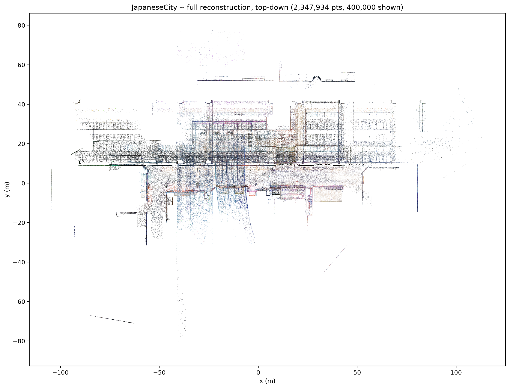
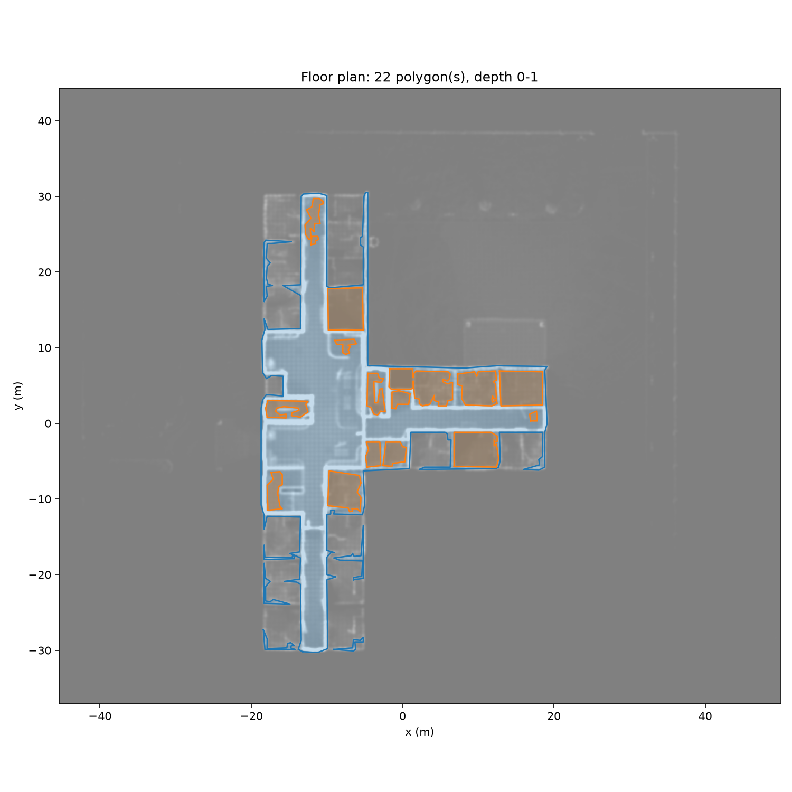

<div align="center">

# HERALD

**A robot that builds its own map as it explores — and understands it well enough to answer
plain-English requests.**



*The 3D map HERALD reconstructed from nothing but a robot's own camera footage.*

</div>

## What it does

No pre-made floor plan. No manually labeled map. You send a robot through a building with a
camera, and HERALD turns what it saw into a map that knows **where things are** and **what each
part of the building is for** — well enough to answer something like:

> *"Help me buy a cola and show me the way to buy a ticket for the train station."*

HERALD finds the vending machine, finds the ticket counter, and plans a route to both.

<div align="center">


*HERALD also figures out the building's own footprint from the same data — no blueprint needed.*
</div>

## How it works, in short

1. **Explore.** The robot walks through the space once (or many times, on different days) with
   a camera.
2. **Remember.** HERALD turns the footage into a 3D map, spotting and remembering every object
   it sees along the way.
3. **Stitch it together.** Multiple walk-throughs get merged into one single, consistent map —
   so the robot's understanding only gets better the more it explores.
4. **Make sense of the space.** Objects get grouped into named areas ("vending machine area",
   "waiting room", "ticket counter") and an AI gives each one a plain-English description.
5. **Ask it anything.** Describe what you need in plain English, and HERALD figures out which
   area(s) to go to and the actual path to get there.

## Try it

The technical setup and commands to run each step yourself are below. For how it's built
internally, see [`CLAUDE.md`](CLAUDE.md).

---

## Setup

Dependencies are managed with [uv](https://docs.astral.sh/uv/) (never `pip`/`venv` directly).

```bash
git clone --recurse-submodules <this-repo>
cd HERALD
uv sync                            # core deps
uv sync --group recon              # + reconstruction (heavy, needs a CUDA GPU)
uv sync --group viewer             # + Rerun viewer, for visualizing results
bash third_party/boxer/scripts/download_ckpts.sh   # detector weights (~1.1 GB)
uv run python scripts/download_tartanground.py --env Hospital --traj P0000 P0001   # demo data
```

## Running the pipeline

Five stages, one command each. All of them just read/write files — rendering/visualizing is a
separate, optional step (`scene_render.py`).

```bash
ENV=Hospital; REC=data/tartanground/$ENV/recon; S=data/tartanground/$ENV/scene

# 1. one session's video -> object boxes + a colored 3D map (needs a GPU)
uv run python scripts/scene_recon.py --env $ENV --traj P0000 --out $REC/session_P0000.npz

# 2. fold it into the persistent, growing map
uv run python scripts/scene_align.py --session $REC/session_P0000.npz --persistent $S/persistent.npz \
  --out $S/sim3_P0000.json --no-align   # --no-align only for the very first session
uv run python scripts/scene_track_obj.py   --session $REC/session_P0000.npz --persistent $S/persistent.npz --sim3 $S/sim3_P0000.json
uv run python scripts/scene_merge_route.py --objects $S/persistent.npz --route $S/route.json --attach $S/attach.json --session P0000 --sim3 $S/sim3_P0000.json
# ... repeat 1-2 for every other session (P0001, P0002, ...) ...

# 3. group objects into named areas
uv run python scripts/scene_area_cluster.py  --objects $S/persistent.npz --route $S/route.json --attach $S/attach.json --out $S/scene_graph.json
uv run python scripts/scene_area_classify.py --graph $S/scene_graph.json --out $S/scene_graph.json   # needs an LLM (Ollama/OpenAI)

# 4+5. ask a question -> get a destination + route
uv run python scripts/scene_plan.py "bring me a wheelchair and take me to the reception desk" \
  --graph $S/scene_graph.json --route $S/route.json --robot-pos 0 0 0 --n-required 2 --geodesic

# see it in Rerun
uv run python scripts/scene_render.py --objects $S/persistent.npz --graph $S/scene_graph.json --route $S/route.json --out $S/scene.rrd
```

The whole flow (all sessions, GPU + CPU stages) also runs as one SLURM job:

```bash
sbatch --export=ALL,ENV_NAME=Hospital,TRAJS="P0000 P0001 P0002" scripts/scene_pipeline.slurm
```

## Learn more

- [`CLAUDE.md`](CLAUDE.md) — full architecture, every script's flags/knobs, the experimental
  contour-anchored alignment mode, and cluster/SLURM details.
- [`PLAN.md`](PLAN.md) — the longer-term roadmap.
- `experiments/` — the research notebooks behind each validated piece of the pipeline.
